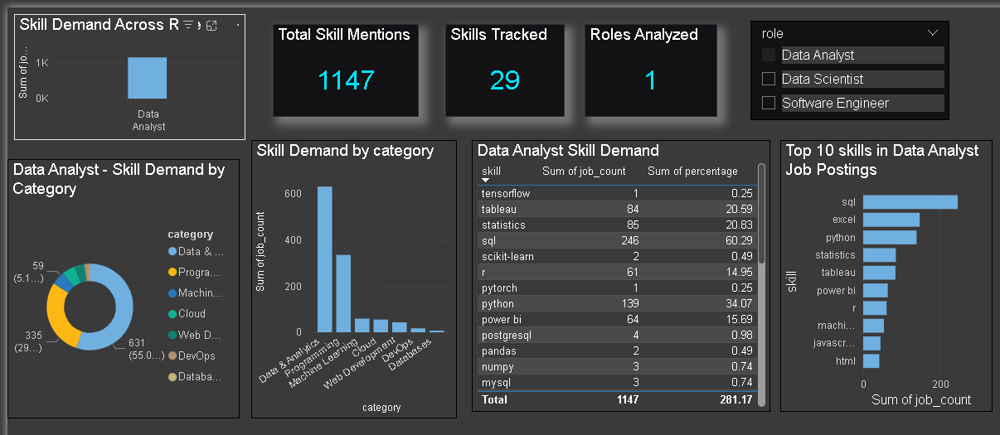

# Job Market Intelligence & Career Assistant

A data-driven career intelligence platform that analyzes job market data, identifies in-demand skills, compares skills across job roles, performs personal skill-gap analysis, and provides career guidance based on job-market demand.

## 📌 Project Overview

The goal of this project is to understand what skills companies are looking for and help students and job seekers identify the skills they should focus on.

The system combines:

- Python
- Pandas
- SQL / MySQL
- Rule-based skill extraction
- FastAPI
- Power BI
- Data analysis
- Career recommendation logic

### Project Workflow

Job Postings  
↓  
Data Cleaning  
↓  
Skill Extraction  
↓  
SQL Database  
↓  
Job Market Analysis  
↓  
Role-wise Skill Analysis  
↓  
Skill Gap Analysis  
↓  
Career Assistant  
↓  
FastAPI + Power BI Dashboard

---

## 📊 Dataset

The project uses a Kaggle dataset containing LinkedIn job postings from 2023–2024.

The original dataset contains approximately 123,849 job postings.

After cleaning:

- 123,842 job postings
- 14 selected columns
- Missing required records removed
- Duplicate job IDs handled
- Text fields cleaned

### Important

This project uses a static dataset and does not collect live LinkedIn job postings.

---

## 🚀 Main Features

### 1. Job Market Data Analysis

Analyzes job postings based on:

- Job title
- Company
- Location
- Experience level
- Work type
- Remote availability
- Salary information
- Job description

### 2. Skill Extraction

The system detects technical skills from job descriptions using rule-based keyword and regular-expression matching.

Tracked skills include:

- Python
- SQL
- Excel
- Power BI
- Tableau
- Pandas
- NumPy
- Machine Learning
- Deep Learning
- Scikit-learn
- TensorFlow
- PyTorch
- Statistics
- R
- MySQL
- PostgreSQL
- AWS
- Azure
- GCP
- Git
- GitHub
- Docker
- Kubernetes
- Java
- JavaScript
- C++
- C#
- HTML
- CSS
- React
- FastAPI
- Flask
- Django

---

## 📈 Data Analyst Skill Analysis

The project analyzed 408 Data Analyst job postings.

Some of the detected skill demand was:

| Skill | Job Count | Percentage |
|------|-----------|------------|
| SQL | 246 | 60.29% |
| Excel | 147 | 36.03% |
| Python | 139 | 34.07% |
| Statistics | 85 | 20.83% |
| Tableau | 84 | 20.59% |
| Power BI | 64 | 15.69% |
| R | 61 | 14.95% |
| Machine Learning | 54 | 13.24% |

These percentages represent skill mentions detected in the analyzed job descriptions.

---

## 🔍 Role-wise Skill Analysis

The project compares skill requirements across different roles.

Currently analyzed roles include:

- Data Analyst
- Data Scientist
- Software Engineer

This helps identify how skill requirements differ between career paths.

### Data Analyst

Commonly detected skills include:

- SQL
- Excel
- Python
- Statistics
- Tableau
- Power BI

### Data Scientist

Commonly detected skills include:

- Python
- SQL
- Machine Learning
- Statistics
- R
- Deep Learning
- PyTorch
- TensorFlow

### Software Engineer

Commonly detected skills include:

- Java
- Python
- SQL
- JavaScript
- AWS
- Azure
- Docker
- Kubernetes
- Git
- C++

---

## 🧠 Skill Gap Analysis

The system allows a user to enter:

1. Target job role
2. Current skills

The API then compares the user's skills with the skills detected for that role.

It returns:

- Total required skills tracked
- Skill match percentage
- Matched skills
- Missing skills
- Skill demand percentages

### Example

Target Role:

Data Scientist

User Skills:

Python, SQL, Excel

The system identifies which tracked skills are already present and which are missing from the user's current skill list.

---

## 💡 Career Assistant

The Career Assistant provides data-driven suggestions based on the skill-gap analysis.

It:

- Identifies matched skills
- Identifies missing skills
- Prioritizes missing skills based on observed demand
- Suggests which skills to focus on first

The current Career Assistant uses rule-based logic and job-market data rather than an external large language model.

---

## ⚡ FastAPI

The project provides REST API endpoints using FastAPI.

### API Endpoints

#### Home

GET /

Checks whether the API is running.

#### Test Database

GET /test-db

Checks the MySQL database connection and returns the total number of jobs.

#### Job Search

GET /jobs

Supports filtering by:

- Job title
- Location
- Remote availability
- Result limit

Example:

/jobs?title=Data%20Analyst&location=New%20York&limit=10

#### Skill Demand

GET /skills

Returns the tracked skill-demand data.

#### Role-wise Skills

GET /role-skills

Returns skill demand for analyzed job roles.

Example:

/role-skills?role=Data%20Scientist

#### Skill Gap

GET /skill-gap

Compares the user's skills with the tracked skills for a selected role.

Example:

/skill-gap?role=Data%20Scientist&skills=Python,SQL,Excel

#### Career Advice

GET /career-advice

Provides data-driven career guidance based on the user's skills and selected role.

Example:

/career-advice?role=Data%20Scientist&skills=Python,SQL,Excel

---

## 📊 Power BI Dashboard

Power BI is used to visualize job-market skill demand.

## Dashboard Preview

The dashboard contains:

- Total Skill Mentions
- Skills Tracked
- Roles Analyzed
- Top 10 Skills
- Skill Demand by Category
- Role comparison
- Skill demand table
- Role slicer for interactive filtering

### Skill Categories

Skills are grouped into categories such as:

- Programming
- Data & Analytics
- Machine Learning
- Cloud
- DevOps
- Databases
- Web Development

The dashboard allows users to select a role and explore its skill-demand pattern.

---

## 🗂️ Project Structure

    ai_job_market_intelligence/
    │
    ├── data/
    │   ├── postings.csv
    │   ├── cleaned_postings.csv
    │   ├── data_analyst_skill_demand.csv
    │   ├── data_analyst_skill_analysis.csv
    │   ├── role_skill_analysis.csv
    │   ├── role_skill_categories.csv
    │   ├── powerbi_role_skill.csv
    │   ├── powerbi_category_demand.csv
    │   └── powerbi_overall_skills.csv
    │
    ├── notebooks/
    │   ├── 01_data_exploration.py
    │   ├── 02_data_cleaning.py
    │   ├── 03_skill_analysis.py
    │   ├── 04_data_analyst_analysis.py
    │   ├── 05_skill_extractor.py
    │   ├── 06_skill_demand_analysis.py
    │   ├── 07_role_skill_analysis.py
    │   ├── 08_skill_categories.py
    │   └── 09_dashboard_data.py
    │
    ├── app/
    │   ├── __init__.py
    │   ├── main.py
    │   ├── database.py
    │   └── career_assistant.py
    │
    ├── database/
    │
    ├── dashboard/
    │
    └── README.md

---

## 🛠️ Technologies Used

### Programming

- Python

### Data Analysis

- Pandas
- NumPy

### Database

- MySQL
- SQL

### Machine Learning / NLP

- Scikit-learn
- Text processing
- Rule-based skill extraction

### Backend

- FastAPI
- Uvicorn

### Visualization

- Microsoft Power BI

### Development Tools

- VS Code
- MySQL Workbench
- Git
- GitHub

---

## ▶️ How to Run the Project

### 1. Clone the Repository

    git clone <your-github-repository-url>

Navigate into the project:

    cd ai_job_market_intelligence

### 2. Install Dependencies

    pip install fastapi uvicorn mysql-connector-python pandas numpy scikit-learn

### 3. Configure MySQL

Create the database:

    CREATE DATABASE job_market_intelligence;

Use the database:

    USE job_market_intelligence;

Create the required tables using the SQL scripts provided in the project.

### 4. Configure Database Connection

Update the database configuration in:

    app/database.py

Do not upload database passwords or other private credentials to GitHub.

### 5. Run the FastAPI Server

From the project root folder:

    python -m uvicorn app.main:app --reload

The API will run at:

    http://127.0.0.1:8000

Swagger documentation is available at:

    http://127.0.0.1:8000/docs

---

## 🔄 Example Project Workflow

    1. Load job posting dataset
            ↓
    2. Clean the data
            ↓
    3. Extract technical skills
            ↓
    4. Store analyzed data in MySQL
            ↓
    5. Analyze skill demand
            ↓
    6. Compare different job roles
            ↓
    7. Visualize results in Power BI
            ↓
    8. Enter personal skills
            ↓
    9. Perform skill-gap analysis
            ↓
    10. Generate career advice

---

## 🎯 Project Objectives

The main objectives of this project are:

- Understand job-market skill demand from a static job-posting dataset
- Identify frequently mentioned technical skills
- Compare skills across different IT roles
- Help users understand their skill gaps
- Provide data-driven career guidance
- Combine data analytics, SQL, backend development, and visualization into one project

---

## 🔮 Future Improvements

Possible future improvements include:

- Live job-data ingestion from permitted sources/APIs
- More job roles and industries
- Better NLP-based skill extraction
- Resume parsing
- Resume-to-job matching
- Personalized learning roadmap
- LLM-based conversational career assistant
- Job recommendation system
- Salary trend analysis
- Cloud deployment
- Authentication and user profiles

---

## ⚠️ Disclaimer

This project is developed for educational and portfolio purposes.

The analysis is based on a static dataset of job postings and should not be treated as a live representation of the entire job market.

Skill percentages represent detected mentions in the analyzed job descriptions and may not always indicate mandatory job requirements.

---

## 👩‍💻 Author

**Kirti Sanas**

M.Sc. Information Technology Student  
B.Sc. Information Technology Graduate

Interested in:

- Data Analytics
- Data Science
- Machine Learning
- Software Development
- Backend Development
- AI & Technology

GitHub:

https://github.com/kirtisanas